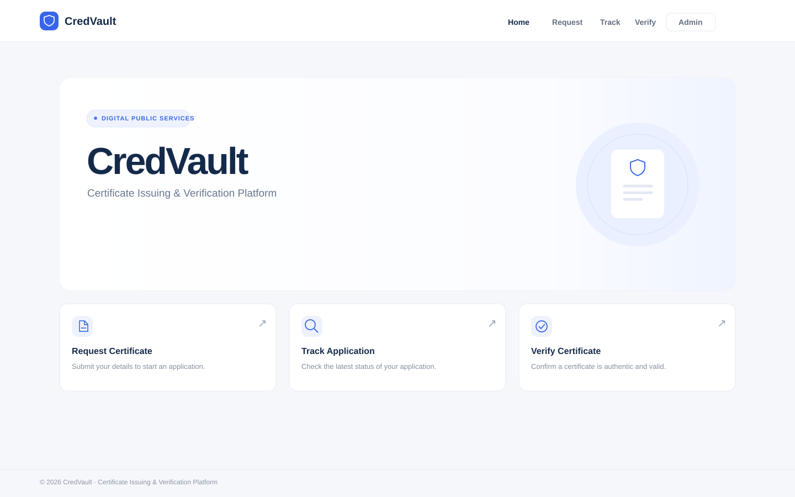
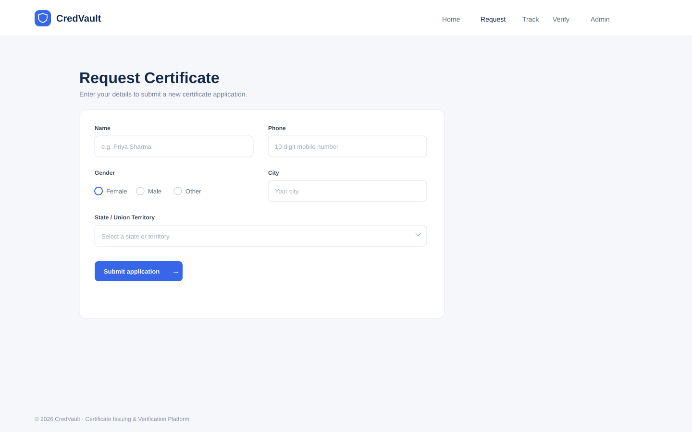
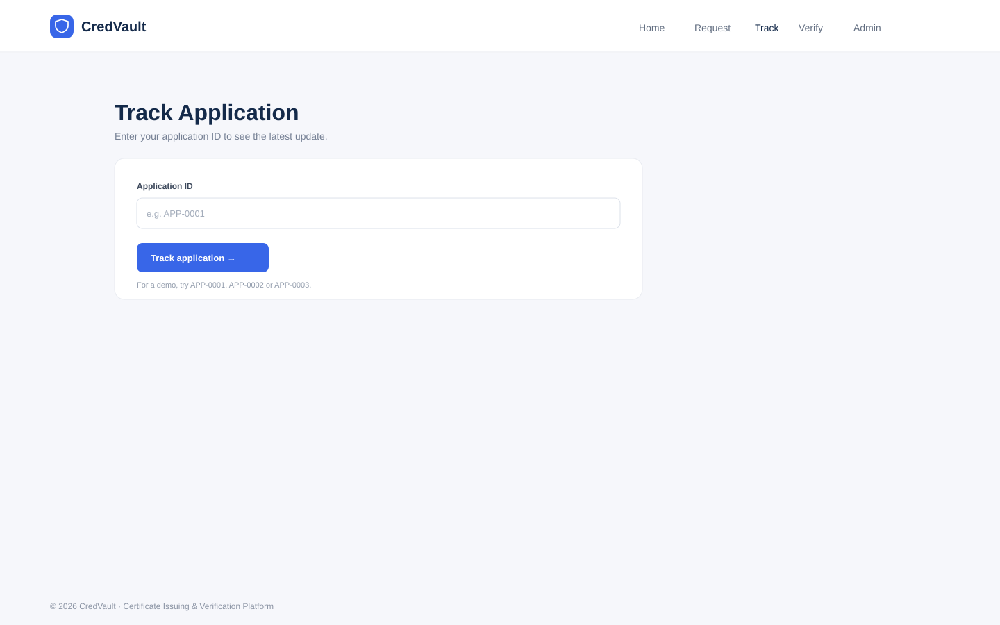
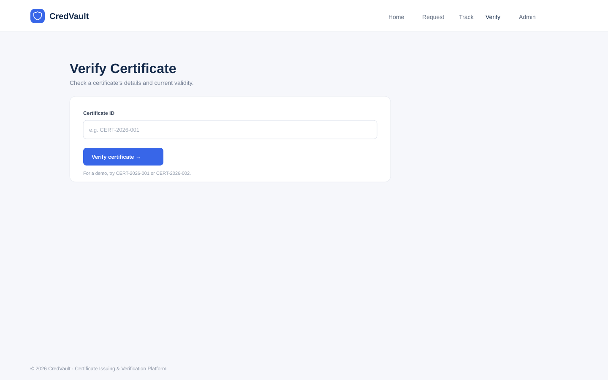
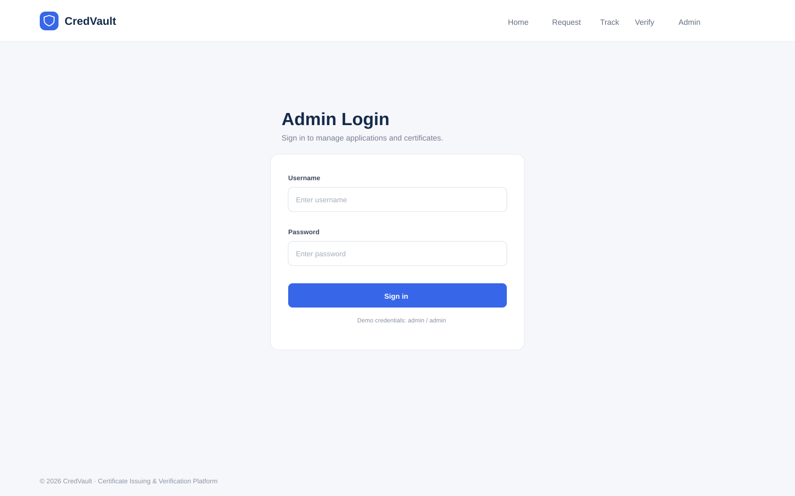
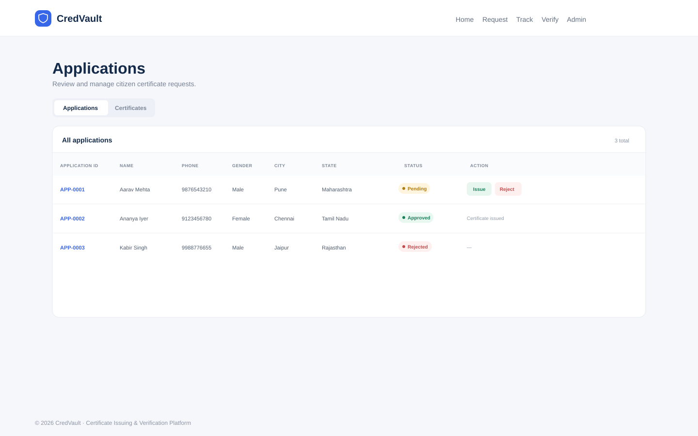
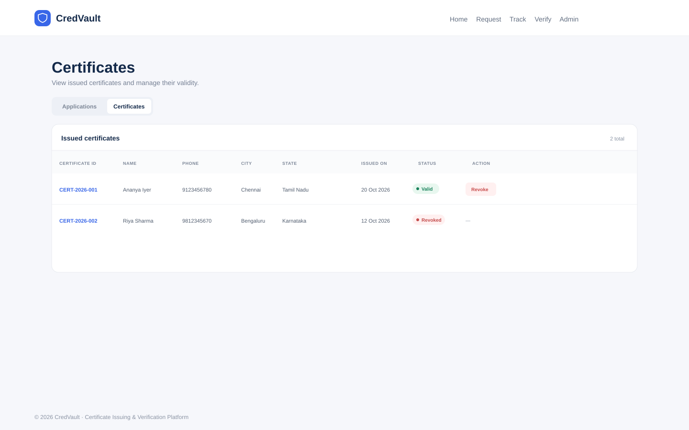

# CredVault — ELEVATE SDE Task 4

CredVault is a full stack certificate request, issuing, tracking, and verification platform. Citizens use the web interface to request certificates, track application status, and verify issued certificates. Admin actions use protected APIs backed by SQLite.

## Technology

- **Frontend:** HTML, CSS, and vanilla JavaScript
- **Backend:** Node.js 22.13+ with the built-in `node:http` server
- **Database:** SQLite using Node's built-in `node:sqlite` module (no npm dependencies)
- **Admin authentication:** PBKDF2-SHA256 password hashes and signed, expiring bearer tokens

## Run locally

Requires Node.js 22.13 or later. Set admin credentials and a stable token secret before the first start. The development fallback is `admin` / `admin`.

```powershell
$env:ADMIN_USERNAME = "admin"
$env:ADMIN_PASSWORD = "change-this-password"
$env:JWT_SECRET = "use-a-long-random-secret"
npm start
```

Open `http://localhost:4173`. The web interface and JSON API run on the same server. SQLite is created at `data/credvault.sqlite`; set `DATABASE_PATH` to choose another location. Admin credentials are created on the first start; changing the environment password later does not replace the saved account.

## Full stack flow

- Request submissions are validated and stored in SQLite; the API returns the real Application ID.
- Application tracking and public certificate verification read current database records.
- Admin login returns an eight-hour bearer token. The UI keeps it in session storage and sends it to protected admin APIs.
- Approving a pending application creates its certificate and updates application status in one transaction.
- Rejecting applications and revoking certificates persist in SQLite. Revocation changes only the certificate status.
- No sample application or certificate records are seeded.

## API routes

All request and response bodies use JSON. Admin endpoints require `Authorization: Bearer <token>` from `/api/admin/login`.

| Method | Endpoint | Access | Purpose |
| --- | --- | --- | --- |
| `POST` | `/api/applications` | Public | Submit an application (`name`, `phone`, `gender`, `city`, `state`) |
| `GET` | `/api/applications/track/:applicationId` | Public | Track application status |
| `GET` | `/api/certificates/verify/:certificateId` | Public | Verify a certificate and current status |
| `POST` | `/api/admin/login` | Public | Authenticate and return an eight-hour token |
| `GET` | `/api/admin/applications` | Admin | List applications |
| `PATCH` | `/api/admin/applications/:applicationId/approve` | Admin | Approve a pending application and create a `Valid` certificate |
| `PATCH` | `/api/admin/applications/:applicationId/reject` | Admin | Reject a pending application; optional `reason` |
| `GET` | `/api/admin/certificates` | Admin | List certificates |
| `PATCH` | `/api/admin/certificates/:certificateId/revoke` | Admin | Revoke a certificate |

The `GET /api/admin/certificates/:certificateId/revoke` route is also supported for compatibility; `PATCH` is preferred. Missing records return `404`, invalid input `400`, invalid credentials `401`, and decisions on non-pending applications `409`.

## Screenshots and walkthrough

The screenshots cover citizen pages and both admin pages. The included walkthrough recording shows the Task 2 interface; the full stack build connects these screens to the live API and database.

[Watch the CredVault walkthrough](CredVault-Walkthrough.webm)

### Home



### Request certificate



### Track application



### Verify certificate



### Admin login



### Admin applications



### Admin certificates



## Repository

https://github.com/ansh31102006/ELEVATE-SDE-Task-4
